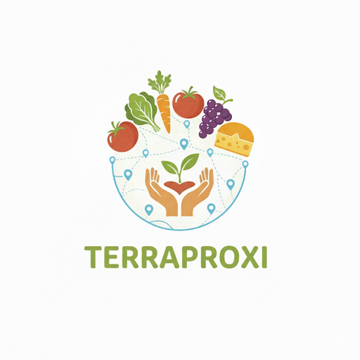

  

<h1 align="center">TerraProxi</h1>

  <strong>La vente directe des producteurs locaux, à portée de main.</strong> 
  Carte des producteurs à proximité, commande et paiement en ligne, messagerie, back-office producteur.

  <a href="https://terraproxi.fr">Site</a> ·
  <a href="https://github.com/TerraProxi/TerraProxi">Code source</a> ·
  <a href="https://github.com/TerraProxi/TerraProxi/tree/main/docs">Documentation</a>

---

## Le projet

TerraProxi met en relation les consommateurs et les producteurs de leur région : marchés, fermes,
artisans. Le consommateur trouve les producteurs autour de lui, commande et paie en ligne, puis
retire sa commande ou se la fait livrer. Le producteur gère son catalogue, ses commandes, son
agenda et ses statistiques depuis un back-office web.

Projet **2427-25** du Cycle d'Innovation Digitale de l'EPSI Montpellier.

| | Fonctionnalités |
|---|---|
| 🗺️ | Recherche géolocalisée des producteurs et des produits |
| 🛒 | Panier multi-producteurs, paiement sécurisé par Stripe |
| 💬 | Messagerie client ↔ producteur, notifications in-app et push |
| 📊 | Back-office producteur : catalogue, commandes, agenda, statistiques de vente |
| 🤖 | Assistant IA et newsletters rédigées par IA (Google Gemini) |
| 🔒 | Conformité RGPD : consentement, export des données, droit à l'oubli |

## Dépôts

| Dépôt | Contenu |
|-------|---------|
| [**TerraProxi**](https://github.com/TerraProxi/TerraProxi) | Monorepo de la plateforme : API, site web, application mobile, specs et documentation |
| [ComingSoon](https://github.com/TerraProxi/ComingSoon) | Page d'accueil publique de [terraproxi.fr](https://terraproxi.fr) |
| [Prototype-Front](https://github.com/TerraProxi/Prototype-Front) | Prototype d'interface de la phase de conception (archivé) |

## Stack technique

`React` · `React Native (Expo)` · `Bun` · `Elysia` · `PostgreSQL` · `PostGIS` · `Stripe` ·
`OpenStreetMap` · `Docker` · `Caddy` · hébergement `OVHcloud` (France)

Le développement suit une démarche **Spec Driven Development** : les contrats OpenAPI, JSON Schema
et Gherkin font foi, et la CI vérifie que l'API les respecte.

## L'équipe

| Membre | Rôle |
|--------|------|
| Gaëtan | Backend, frontend, tests |
| Mylo | Backend, frontend |
| Théo | Frontend, backend |
| Dunvael | Infrastructure, gestion de projet |
| Louis | IA et data, gestion de projet |

## Contribuer

Les règles communes à tous les dépôts sont dans [TerraProxi/.github](https://github.com/TerraProxi/.github) :
[contribution](https://github.com/TerraProxi/.github/blob/main/CONTRIBUTING.md) ·
[sécurité](https://github.com/TerraProxi/.github/blob/main/SECURITY.md) ·
[code de conduite](https://github.com/TerraProxi/.github/blob/main/CODE_OF_CONDUCT.md).
